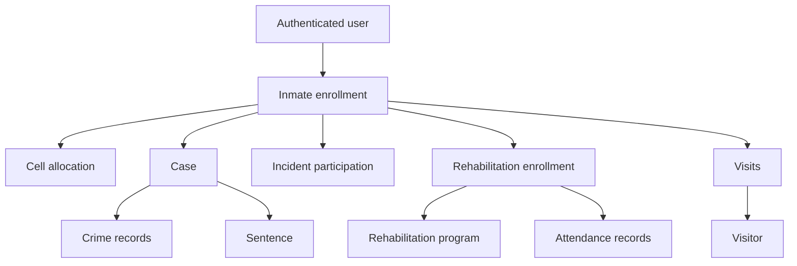

# Inmate Management Workflow

This document describes how inmate enrollment, cell allocation, cases, sentences, incidents, rehabilitation, and visits are connected in the current API implementation.

## High-level relationship



The inmate is the central record. Other workflows reference the inmate record, but they do not replace it or create a second inmate record.

## Identifier rules

Each persisted resource has two identifier concepts:

- The UUID is the public API identifier. Use it in URL path variables, request-body references, query filters, and response objects.
- The sequential numeric ID may remain an internal database key. Clients must not use or depend on it.
- `inmateNumber` is a separate business identifier. It is required and unique, but it is not the API resource identifier.

For example, an inmate may have:

```json
{
  "id": "0f8fad5b-d9cb-469f-a165-70867728950e",
  "inmateNumber": "INM-000245",
  "firstName": "John",
  "lastName": "Banda"
}
```

The UUID identifies the API resource, while `inmateNumber` identifies the inmate in prison business processes.

## 1. Inmate enrollment

Endpoint:

```text
POST /api/v1/inmates
```

The records officer or super administrator submits the required inmate profile:

```json
{
  "inmateNumber": "INM-000245",
  "firstName": "John",
  "lastName": "Banda",
  "dateOfBirth": "1990-04-12",
  "gender": "Male",
  "admissionDate": "2026-10-16",
  "classification": "Minimum"
}
```

The service creates the inmate in the `inmates` table and assigns a public UUID. The current facility is taken from server configuration rather than trusted from the request body.

Important rules:

- `inmateNumber` is required and unique.
- First names and last names are not unique and may be shared by multiple inmates.
- A duplicate inmate number returns a conflict response.
- The newly created inmate UUID is used in all subsequent workflows.

Useful follow-up endpoint:

```text
GET /api/v1/inmates/{inmateUuid}
```

## 2. Cell allocation

Cells are created independently before an inmate can be allocated:

```text
POST /api/v1/cells
```

Example:

```json
{
  "blockName": "A",
  "cellNumber": 12,
  "capacity": 4,
  "classification": "Minimum"
}
```

After the inmate and cell exist, allocate the inmate:

```text
POST /api/v1/inmates/{inmateUuid}/cell-allocation
```

```json
{
  "cellId": "6ba7b810-9dad-11d1-80b4-00c04fd430c8"
}
```

The allocation links one inmate to one cell. The current implementation enforces:

- The inmate must exist.
- The cell must exist.
- The inmate classification must match the cell classification.
- The cell must have available capacity.
- An inmate may have only one active allocation because `inmate_id` is unique in `cell_allocations`.

To move an already allocated inmate:

```text
PUT /api/v1/inmates/{inmateUuid}/cell-allocation
```

The target cell must pass the same classification and capacity checks. Moving to the same cell is rejected.

Cell allocation is not required to create a case, sentence, incident, rehabilitation enrollment, or visit. Those workflows reference the inmate directly.

## 3. Cases and crimes

Crimes are reference records used by cases:

```text
POST /api/v1/crimes
```

Create a case for an enrolled inmate:

```text
POST /api/v1/cases
```

```json
{
  "inmateId": "0f8fad5b-d9cb-469f-a165-70867728950e",
  "caseNumber": "CASE-2026-0042",
  "court": "High Court",
  "caseStartDate": "2026-10-16",
  "caseEndDate": "2026-11-30",
  "crimeIds": [
    "6ba7b810-9dad-11d1-80b4-00c04fd430c8"
  ]
}
```

The case links:

- One inmate.
- Zero or more crime records.
- The authenticated user who created it.

The inmate must exist, and every crime UUID supplied must resolve to an existing crime. The case start date cannot be after the case end date.

Case endpoints include:

```text
GET   /api/v1/cases/{caseUuid}
PUT   /api/v1/cases/{caseUuid}
PATCH /api/v1/cases/{caseUuid}/status
GET   /api/v1/inmates/{inmateUuid}/cases
```

Case status controls whether a sentence may be created. A new case starts as ongoing. The implementation allows sentence creation only while the case is ongoing. Closed or appealed cases cannot receive a new sentence through the current service rules.

## 4. Sentences

A sentence must reference both an existing case and an inmate:

```text
POST /api/v1/sentences
```

```json
{
  "caseId": "case-public-uuid",
  "inmateId": "inmate-public-uuid",
  "duration": 24,
  "startDate": "2026-12-01",
  "releaseDate": "2028-12-01",
  "status": "active"
}
```

The service verifies two important relationships before saving:

1. The case exists.
2. The inmate supplied in the request is the same inmate attached to the case.

This prevents a sentence for inmate B from being attached to inmate A's case. The sentence is also rejected if the case is no longer ongoing.

Sentence endpoints include:

```text
GET /api/v1/sentences/{sentenceUuid}
PUT /api/v1/sentences/{sentenceUuid}
GET /api/v1/inmates/{inmateUuid}/sentences
```

## 5. Incidents and incident history

An incident may involve one or more existing inmates:

```text
POST /api/v1/incidents
```

```json
{
  "incidentDate": "2026-10-16",
  "description": "Unauthorized altercation",
  "participants": [
    {
      "inmateId": "inmate-public-uuid",
      "roleInIncident": "Instigator"
    }
  ]
}
```

The incident uses a join record to connect inmates to incidents and store each participant's role. The same inmate cannot be listed twice in one incident, and every participant UUID must identify an existing inmate.

Incident endpoints include:

```text
PATCH /api/v1/incidents/{incidentUuid}/outcome
GET   /api/v1/inmates/{inmateUuid}/incidents
```

Recording an outcome changes an incident from open to resolved. The operation is write-once and a second outcome update is rejected.

## 6. Rehabilitation programs, enrollment, and attendance

A rehabilitation program is created independently:

```text
POST /api/v1/rehabilitation/programs
```

The program must be active before an inmate can enroll. Enrollment then links an inmate to the program:

```text
POST /api/v1/rehabilitation/enrollments
```

```json
{
  "inmateId": "inmate-public-uuid",
  "programId": "program-public-uuid",
  "enrollmentDate": "2026-10-20"
}
```

The current implementation prevents another active or suspended enrollment for the same inmate and program combination.

Enrollment status transitions are controlled by the service:

```text
PATCH /api/v1/rehabilitation/enrollments/{enrollmentUuid}/status
```

An enrollment may move between enrolled, suspended, completed, and withdrawn according to the allowed transition rules. A reason is required for suspension, completion, or withdrawal.

Attendance references the enrollment, not the inmate directly:

```text
POST /api/v1/rehabilitation/attendance
```

```json
{
  "enrollmentId": "enrollment-public-uuid",
  "sessionDate": "2026-10-21",
  "attendanceStatus": "present",
  "remarks": "Attended scheduled session"
}
```

Attendance requires the enrollment to be active and the session date cannot be before the enrollment date. Duplicate attendance for the same enrollment and session date is rejected.

## 7. Visitors and visits

A visitor is a separate person record:

```text
POST /api/v1/visitors
```

A visit links an existing visitor, inmate, and authenticated user:

```text
POST /api/v1/visits
```

```json
{
  "visitorId": "visitor-public-uuid",
  "inmateId": "inmate-public-uuid",
  "visitDateTime": "2026-10-22T10:00:00Z",
  "durationMinutes": 60
}
```

The visitor does not become part of the inmate record. The visit is a separate relationship that can be searched by visitor, inmate, date, or user who logged it.

## Recommended operational sequence

For a normal intake workflow, use this order:

1. Authenticate as an authorized records or administrative user.
2. Create the inmate and save the returned `inmateUuid`.
3. Confirm or create an appropriate cell.
4. Allocate the inmate to the cell using the inmate UUID and cell UUID.
5. Create crimes if the required crime references do not exist.
6. Create the inmate's case using the inmate UUID and crime UUIDs.
7. Create a sentence using the case UUID and the same inmate UUID, if applicable.
8. Record incidents using the inmate UUID when incidents occur.
9. Create or select an active rehabilitation program.
10. Enroll the inmate using the inmate and program UUIDs.
11. Record attendance using the enrollment UUID.
12. Register visitors and record visits using visitor and inmate UUIDs.

Cell allocation, rehabilitation, incidents, and visits are related to the inmate but are not prerequisites for creating a case or sentence. The explicit prerequisite for a sentence is a valid case whose inmate matches the sentence inmate and whose case status permits sentencing.

## Integrity checks when testing the workflow

Verify the following after each operation:

- The returned resource contains a UUID.
- UUIDs remain stable after retrieval and update.
- The UUID in each child request belongs to the intended parent inmate.
- A sentence cannot attach an unrelated inmate to a case.
- An inmate cannot be allocated to a classification-incompatible or full cell.
- Duplicate enrollment and duplicate attendance are rejected without creating extra rows.
- Failed requests do not create partial relationship records.
- Numeric database IDs are not used in client-facing URLs, request bodies, response objects, or generated links.
